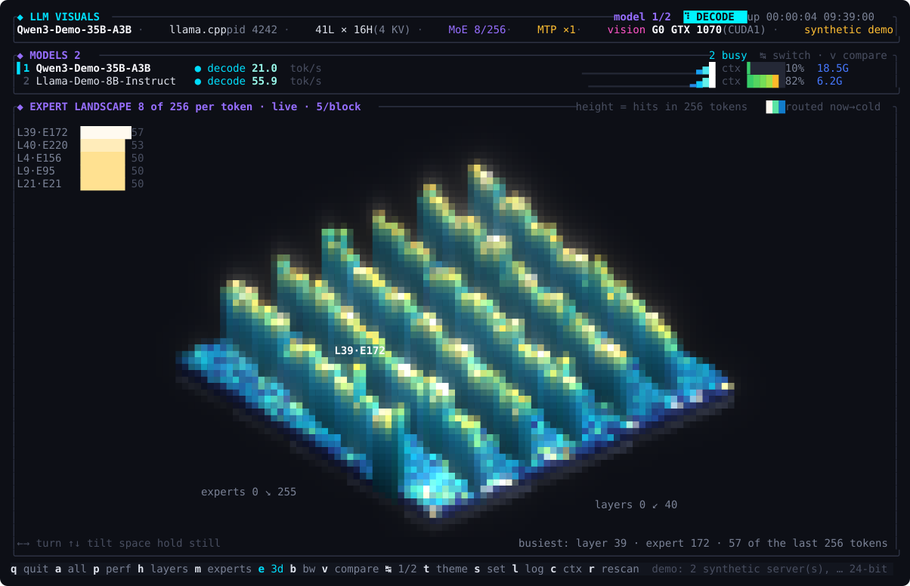
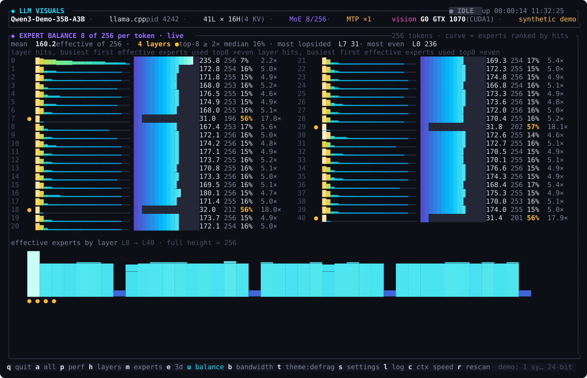

# llm-visuals

**A live terminal dashboard for the LLM running on your machine.**

It finds the inference servers you already have up (llama.cpp `llama-server`,
ollama, vLLM, SGLang, Strata, Maya, NInfer, …), reads their counters and NVIDIA, AMD or Intel
GPU telemetry, and turns them into a truecolor picture of what the model is doing
right now: tokens per second, time to first token, GPU load and memory, context fill, speculative-decoding
acceptance, which layers are busy on which GPU, and, with a small server patch,
exactly which experts a mixture-of-experts model routed the last token through.

Every number on screen comes from the server, the driver, or arithmetic on
those. The one thing that can be a visual stand-in (expert identities without
the patch) is labelled as such on screen.


<sub>Live session, 140×44: Qwen3.6-35B-A3B (256 experts, MTP) on a GTX 1070 and
a Tesla P100 under llama.cpp, mid-request.</sub>

---

## Contents

- [Quick start](#quick-start)
- [Windows](#windows)
- [macOS](#macos)
- [Building and cross-compiling](#building-and-cross-compiling)
- [What you see](#what-you-see)
- [Several models at once](#several-models-at-once)
- [Alerts](#alerts)
- [Benchmark](#benchmark)
- [Keys](#keys)
- [Where every number comes from](#where-every-number-comes-from)
- [Server setup: metrics and real expert routing](#server-setup-metrics-and-real-expert-routing)
- [Command-line options](#command-line-options)
- [Replay](#replay)
- [Troubleshooting](#troubleshooting)
- [How it works](#how-it-works)
- [Contributing and license](#contributing-and-license)

---

## Quick start

Requirements: a Rust toolchain (1.75+), `nvidia-smi` for NVIDIA GPU panels,
`xpu-smi` for Intel GPU panels or the Linux amdgpu driver for AMD GPU panels,
`macmon` for Apple silicon GPU panels (or run under `sudo` for `powermetrics`),
and a locally listening
`llama-server` for throughput panels. Nothing at all is needed for demo mode.

On Windows 11, see [Windows](#windows) for setup; on a Mac, see
[macOS](#macos). Prebuilt binaries for all three, on x86-64 and ARM64, are
attached to each [release](https://github.com/DingoOz/llm-visuals/releases) —
see [Building and cross-compiling](#building-and-cross-compiling) to make your
own.

```sh
git clone https://github.com/DingoOz/llm-visuals
cd llm-visuals
cargo run --release -- --demo      # synthetic server + two synthetic GPUs
cargo run --release                # attach to the LLM server that is running
```

Or install the binary:

```sh
cargo install --path .
llm-visuals
```

The dashboard auto-detects the server: it lists GPU compute processes, scans
`/proc` for anything that looks like an inference engine, parses the command
line for the model path, port, context size and tensor split, and reads the
GGUF header for the architecture. Press `r` to rescan at any time.

---

## Windows

Windows 11 support is new and has only been type-checked for Windows, not
run on it yet. The checklist below lists what to test; please report results
in an issue.

### What to install

1. **Visual Studio Build Tools** with the *Desktop development with C++*
   workload ([download](https://visualstudio.microsoft.com/visual-cpp-build-tools/)).
   Rust's default Windows toolchain links with it, and the bundled SQLite used by
   `--log-db` is compiled with its C compiler.
2. **Rust** via [rustup](https://rustup.rs) (`rustup-init.exe`), keeping the
   default `x86_64-pc-windows-msvc` toolchain.
3. **Git**: [Git for Windows](https://git-scm.com/download/win), or
   `winget install Git.Git`.
4. **NVIDIA driver** for GPU panels. Current drivers put `nvidia-smi.exe` in
   `C:\Windows\System32`; check with `nvidia-smi` in a new terminal.
5. **Windows Terminal** (preinstalled on Windows 11). The old console host
   renders the dashboard poorly.
6. Optional: **Python 3** from python.org with `pip install torch transformers`,
   only for the `--model <hf-id>` attention view. The dashboard runs `python`
   on Windows, so it must be on the `PATH`.

Then, in PowerShell:

```powershell
git clone https://github.com/DingoOz/llm-visuals
cd llm-visuals
cargo run --release -- --demo
cargo run --release
```

Windows Terminal is detected as truecolor (`WT_SESSION`); in any other
console, pass `--color truecolor` if colours look flat.

### What differs from Linux

- **Detection** lists processes through the OS (via the `sysinfo` crate)
  instead of `/proc`. Run the dashboard as the same user as the server.
  Windows hides the command line of a process started by another user or as
  administrator, so that server is matched by name only: it is assumed to be on
  its engine's default port (8080 for llama.cpp, 11434 for Ollama, 30000 for
  SGLang, 8000 for vLLM), and the model name, context size and GGUF details are
  missing. Starting the dashboard from an administrator terminal should also
  expose them.
- **GPU memory per process**: Windows drivers report it as `[N/A]`, so a
  server shows 0 MB in the model strip. Card-level VRAM is unaffected.
- **Memory pipeline (`b`)**: RAM totals and the server's resident memory come
  from the OS. There are no system-wide disk-read, page-cache or page-fault
  counters, so the DISK stage shows "no disk counters". The per-process read
  rate counts every read the process makes (files, pipes, sockets), so it runs
  higher than on Linux. PCIe traffic needs `nvidia-smi dmon`, which Windows
  drivers may not support; the meter switches itself off after three failures.
- **Servers in WSL2 or Docker** are reachable via their published localhost
  ports. Auto-detection probes local inference ports (e.g. 7000, 8000, 8080,
  11434, 30000), or you can point directly at the server with
  `--endpoint http://localhost:7000/v1` (or set `LLM_ENDPOINT`). Note that endpoints
  use plain HTTP over TCP (HTTPS / TLS is not supported). Specifying an explicit
  `--endpoint` (or `--model http://...`) attaches to that server directly and is
  exempt from `--pid` filtering.

### What to test

- [ ] `cargo build --release` completes (MSVC linker and SQLite C build found).
- [ ] `--demo` renders every view (`a` `p` `h` `m` `e` `u` `b` `v`) and `q` restores
      the terminal.
- [ ] Colours: truecolor is picked automatically in Windows Terminal.
- [ ] GPU panels show utilisation, VRAM, power and temperature from `nvidia-smi`.
- [ ] A native `llama-server.exe --metrics` is detected with the right model
      name, port and context size, and throughput updates during a request.
- [ ] Same server on a non-default `--port`.
- [ ] The Ollama app (`ollama.exe`, port 11434) is detected.
- [ ] A server started from an administrator terminal, with the dashboard in
      a normal one: detected by name on the default port?
- [ ] `r` rescans after a server is started or stopped; several servers at
      once show in the model strip.
- [ ] Memory pipeline: RAM and per-process read rate move while a model
      loads; whether the PCIe meter works or turns itself off cleanly.
- [ ] Model paths with spaces (e.g. under `C:\Users\Jane Doe\models`). The
      command line is split on whitespace, so the path and the GGUF details
      are likely to be missing.
- [ ] With no flags, rows are written to `%LOCALAPPDATA%\llm-visuals\llm.db`;
      `--log-db llm.db` writes there instead; a path that cannot be created
      (e.g. on a missing drive) fails with a readable error.
- [ ] `s`, change a value, `w`: `%APPDATA%\llm-visuals\settings.json` is
      written and the value is used at the next launch.
- [ ] `--model <hf-id>` starts the Python bridge.
- [ ] Resizing the window and very small window sizes.

---

## macOS

macOS support is new and has only been run on Apple silicon. Both Apple
silicon and Intel are built and released; please report results in an issue.

Requirements are the same as elsewhere; on Apple silicon the GPU panels read
from `macmon` (brew install macmon, or `cargo install macmon`) — or from the
built-in `powermetrics` when running under `sudo` (see
[What differs from Linux](#what-differs-from-linux)). Intel Macs have no
GPU panels, like Windows had none before `nvidia-smi`. Everything driven by
the server's own metrics — throughput, context, MTP acceptance, layers and
experts — works as it does on Linux.

### What differs from Linux

- **Detection** lists processes through the OS (via the `sysinfo` crate)
  instead of `/proc`, exactly as on Windows. Run the dashboard as the same
  user as the server, or the server's command line — and with it the model
  path, port and context size — is hidden and it is matched by name alone.
- **Apple silicon GPU panels**: the source is chosen once at startup. It is
  the built-in `powermetrics` when running as root, or when `sudo -n` works
  without a password prompt; otherwise a long-lived sudoless `macmon pipe`
  stream; otherwise a one-line error naming both. Either source samples
  every 250 ms and reports the same two things about the GPU: the share of
  the interval it was active, which is the utilisation shown, and its power.
  `macmon` adds temperature, clock, fans and system RAM. `powermetrics` has
  none of those, so they read `n/a` under `sudo` unless `macmon` is
  installed too, in which case it fills them in. If the `powermetrics`
  stream stops or prints something unrecognised, the rest of the session
  reads `macmon`. A `macmon` older than 0.8 has no time-active figure; its
  frequency-weighted one is shown instead. A virtual Mac has no GPU figures
  to read: `powermetrics` prints empty samples there and `macmon` exits,
  and the panel shows what each of them said. `llm-visuals --print-gpu`
  (add `--json` for a machine-readable record) prints the source that was
  chosen and one parsed sample without opening the dashboard, which is the
  thing to paste into an issue.
- **Power gauge**: Apple publishes no GPU power limit, so the gauge is
  scaled to the largest GPU-cluster draw seen since the dashboard started:
  GPU, ANE and RAM from `macmon`, GPU and ANE from `powermetrics`, the CPU
  excluded. It is a share of the session's peak, not of a rated maximum.
- **VRAM / unified memory**: Apple silicon parts have no device memory, so
  the VRAM stage of the memory pipeline (`b`) is labelled `UNIFIED` and shows
  pool fill — server-reported occupancy when available, otherwise the whole
  system RAM in use — over the installed pool. The pool comes from `macmon`;
  with `powermetrics` alone the bar fills only once a server reports its
  occupancy. There is no memory controller to watch, so its busy % reads
  `n/a`, and the PCIe stage is labelled `C2C` and reads `n/a` (NVLink-C2C
  traffic has no counter).
- **Memory pipeline (`b`)**: RAM totals and the server's resident memory come
  from the OS; the DISK stage has no counters to read.
- **Settings** go to `~/Library/Application Support/llm-visuals/settings.json`
  and the log database to the same directory.

---

## Building and cross-compiling

`cargo build --release` on the machine you want to run on is always the
simplest route, and needs only a Rust toolchain and a C compiler (the SQLite
used by `--log-db` is bundled as C source and built from scratch).

Six targets are built and released:

| | x86-64 | ARM64 |
|---|---|---|
| **Linux** | `x86_64-unknown-linux-gnu` | `aarch64-unknown-linux-gnu` |
| **macOS** | `x86_64-apple-darwin` | `aarch64-apple-darwin` |
| **Windows** | `x86_64-pc-windows-msvc` | `aarch64-pc-windows-msvc` |

`.github/workflows/release.yml` builds all six on GitHub Actions — each on a
runner of its own architecture, except the Intel Mac binary which
cross-compiles from the ARM64 macOS runner — and attaches them to the release
for a pushed `v*` tag. `.github/workflows/ci.yml` compiles and tests on all
three operating systems on every pull request, and additionally cross-compiles
the ARM and Windows targets that no runner there covers.

### Cross-compiling locally

`scripts/cross-build.sh` builds the same set from one machine and writes
archives to `dist/`:

```sh
./scripts/cross-build.sh                 # every target this host can link
./scripts/cross-build.sh windows-arm64   # or one at a time
```

Anything other than the host target needs [zig](https://ziglang.org/download/)
and `cargo-zigbuild`, which supply the cross C compiler and linker that the
bundled SQLite needs:

```sh
cargo install cargo-zigbuild
pipx install ziglang          # or: brew install zig, or a tarball on the path
```

Two things to know about the result:

- **Windows** binaries are built for the `*-pc-windows-gnullvm` targets rather
  than `*-pc-windows-msvc`, because those are the ones zig can link. They are
  ordinary `.exe` files that need no toolchain installed to run; the released
  binaries are the msvc ones, built natively.
- **macOS** binaries cannot be cross-compiled without Apple's SDK, which is
  not redistributable: `sysinfo` links against the `CoreFoundation` and
  `IOKit` frameworks, which zig does not carry. The script skips those two
  targets unless `SDKROOT` points at a `MacOSX.sdk` you already have. Build
  them on a Mac, or let the release workflow do it.

Linux binaries are linked against glibc 2.28 by default so they run on
distributions older than the build host; set `GLIBC=` to link against the
host's own instead.

---

## What you see

### Throughput


<sub>Performance zoom (`p`): tall history for decode and prefill rates, per-GPU
utilisation and power, and a longer request log.</sub>

Decode tokens/sec in large numerals, prefill tokens/sec, time to first token,
tokens per joule across all GPUs, session totals, and history sparklines.
Rates are computed over a one-second sliding window, which matters: speculative
decoders land tokens in bursts, and a per-poll rate flickers. On a test request
the server reported 24.3 tok/s and 412 ms prompt time; the dashboard showed
23.8 tok/s and a 0.38 s time to first token.

Impossible samples are cut before they reach the display. An engine
occasionally emits one: a slot counter jumps and one poll appears to carry a
whole request's tokens, or a self-reported rate is simply wrong — 1500 tok/s
from a model that tops out at 75. Untreated, that single poll latches the
session peak and squashes the sparklines into a flat line until restart. A
rate is now shown only when it is physically possible (finite, under a
ceiling no hardware reaches) and, for decode, plausible for that server: above
both 4× the median of the recently accepted samples and that median + 20
tok/s, it is glitch, and the panel holds the last real reading. Prefill gets
only the ceiling, since a cold prompt after cached follow-ups really is that
much faster. A genuine change of level
— faster model, deeper speculation — is held for a few polls at most: six
rejected in a row (≈3 s at the default poll rate) re-anchor the reference,
and the new speed is shown as fact.

Under the session totals, an energy row adds up what the GPUs have drawn
since the dashboard started — `GPU energy 2.23 Wh` — and, for the focused
model, the energy per thousand generated tokens. With `--energy-price` set it
also prices both: the session so far and a million tokens
(`· $0.0007 · 3.12 Wh/1k tok · $0.937/1M tok`); on a narrow panel the
session cost goes first, then the per-million figure.

It is GPU board power as the driver reports it (NVML, amdgpu hwmon,
xpu-smi, powermetrics / macmon), summed over every card shown — the same
reading tok/J divides by — not power at the wall: CPU, RAM, fans and power
supply losses are not in it. Cards without a power sensor add nothing, and
when none has one the row says `no power readings`. The session figure is
for the whole box, idle time included. The per-token figure counts only the
time the focused model was the only one working, prefill included, since a
prompt has to be read before anything is generated: two models busy at once
on shared cards draw one power reading between them and nothing says how to
divide it, so that time and its tokens are left out of both models' figures.
A gap of more than 5 s between GPU readings (a stalled driver call, a
suspended laptop) is skipped rather than billed at the last wattage seen.

### GPUs

One card per device: utilisation gauge with a VU-style peak-hold notch, power
gauge, temperature coloured by heat (plus the memory temperature on the
NVIDIA cards that report it), SM clock, fan, PCIe link, the card's peak
memory bandwidth where the line has room for it, a VRAM bar split into
weights / KV in use / KV reserved / free, and utilisation and power history
sparklines.

When the driver is holding an NVIDIA card's clocks down, a badge after the
power reading says why, so a sudden drop in decode speed has its cause on
screen:

| Badge | Driver reason |
|---|---|
| `⚠THERM` red | hardware thermal slowdown (clocks halved or worse) |
| `⚠BRAKE` red | hardware power brake: an external signal, usually the power supply |
| `⚠HW` red | hardware slowdown not explained by either of the above |
| `⚠THERM` amber | software thermal cap: past the card's maximum operating temperature |
| `⚠PWR` amber | software power cap: drawing the power limit |
| `SYNC` grey | held to the slowest card of a sync-boost group |
| `APP` grey | held to the configured application clocks |

Several reasons at once read worst first (`⚠THERM+PWR`). Idle and the display
clock setting are not shown: neither slows a token down. A reason stays up
for 1.5 s after the driver last reported it, so one that is on for a single
200 ms poll can still be read; it is never shown longer than that. It is the
last of the optional stats to be dropped on a narrow card: the clock, fan and
PCIe go first, and if the badge still has no room it takes it from the
utilisation gauge. Cards whose driver does not report reasons (AMD, Intel,
Apple, some virtual GPUs) show nothing.

Below the cards, a system RAM section shows memory in use / page cache / free
against the machine's total, the focused model's resident size, and a history
of RAM in use. It is on both the dashboard and the perf view, and is the first
thing the panel drops on a short terminal.

### Vision encoder

When the model has a vision encoder loaded, the header says where it runs:
`vision CPU`, or the card in the GPU panel's numbering followed by the
engine's own name for it, e.g. `vision G1 RTX 3070 (CUDA0)`. llama.cpp puts
the projector (`--mmproj`) on a device of its own, independent of
`--device` and `--tensor-split`: the first CUDA device unless
`--no-mmproj-offload` or `--mmproj-device` (`MTMD_BACKEND_DEVICE`) says
otherwise. CUDA numbers cards fastest-first by default, not in nvidia-smi's
PCI order, so `CUDA0` is often not `G0`; the dashboard asks the CUDA driver
which card each ordinal is, under the server's own `CUDA_VISIBLE_DEVICES` and
`CUDA_DEVICE_ORDER`. vLLM and SGLang shard the vision tower over the model's
own GPUs (`vision G0+G1`).

### Context and MTP

The context bar shows cached, prompt and generated tokens against the window
with a pulsing head while the model works, plus cache-hit rate, KV cache types,
flash-attention and slot occupancy. Beside it the MTP panel shows speculative
decoding health: windowed acceptance rate, mean accepted tokens per
verification step, verification steps per second, an acceptance history and
session totals.

### Layers and experts


<sub>Expert zoom (`m`): one block per expert per layer, two experts per block at
this width, showing the router's real choices from `GET /experts`. Colour is
time since the expert was routed: white now, cooling to dark over about 0.6 s.</sub>

The layer panel draws one tile per transformer layer, tagged with the GPU it
lives on, coloured by that GPU's load with fast attack and slow release, each
carrying its own small history. The expert panel, for MoE models, draws one
block per expert per layer. With the server patch described below, the blocks
show the router's real choices and the title reads `live · N/256 active` (N is
the mean number of distinct experts each layer touched over its last 256
tokens). Without the patch the title reads `simulated`: the timing is real
(each new token re-routes every layer) but the identities are a stand-in.

Layers with tensors in system RAM are tagged `C`. llama.cpp keeps them there
when told to — `-ot` / `--override-tensor` rules, `--cpu-moe`,
`--n-cpu-moe N`, `--n-cpu-ffn N`, or their `LLAMA_ARG_*` environment
variables — and the dashboard applies the same rules to the GGUF tensor
table: a layer whose experts are in RAM but whose attention is on card 0
reads `0C`, a layer entirely in RAM reads `C`, and the panel title counts
them (`C 8 in RAM`). A rule that pins tensors to a card (`=CUDA1`) moves
the layer's tag to that card. The tags need tiles at least five cells wide.



<sub>Expert landscape (`e`), `--demo`, 140×44: the routing of the map above,
stood up. Each tower is a block of experts in one layer; its height is how
often the router picked it over the server's window, and its crown lights
while it is being picked.</sub>

The landscape (`e`) is the expert map as an isometric height field. Experts
run along one edge of the plinth and layers along the other. A tower's
**height** is its hit count over the server's sliding window (`recent` from
`GET /experts`), scaled to the busiest expert of any layer so that layers
compare; that expert is named on the picture and the five busiest are listed
in the corner. A tower's **light** is how often it is being picked right now,
measured against the busiest part of the field and taken from the same
per-expert heat the flat map colours by. Height is the last few hundred tokens
and light is the last second, so when a prompt changes subject new towers
light first and then grow, while the old ones go dark and then sink.

When there are more experts or layers than the panel has pixels they are
grouped, and the title says `N/block`: a block stands as tall as its tallest
expert and is lit by the mean of its members. Without the server patch there
are no hit counts, so the plain stays flat, the title reads `simulated`, and a
stand-in pick only lifts its tile for a moment. A dense model, the attention
bridge and a panel under 60×18 get the flat map instead, laid out as `m` is.

`←` `→` turn the view to the next corner, `↑` `↓` tilt it, and `space` stops
or restarts the slow sway. The view takes the context and MTP row's space as
well. It is drawn two pixels to a cell with half blocks, supersampled, with a
soft glow in truecolor; a 256-colour terminal gets it without the glow.



<sub>Expert balance (`u`), `--demo`, 140×44: four layers whose router has all
but collapsed onto a dozen experts stand out from the rest of the model.</sub>

The balance view (`u`) asks of the same counts whether the router is
spreading its work or collapsing onto a few experts, and in which layers.
One row per MoE layer, from that layer's hits over the server's window
(`recent` from `GET /experts`, 256 tokens with the patch):

- **curve**: the layer's experts ranked by hits, busiest at the left, each
  level the mean of the ranks it covers against the busiest expert. A
  collapsed router is one tall bar and then nothing; a balanced one stays
  high all the way across.
- **effective experts**: exp(Shannon entropy) of the layer's hit shares —
  how many equally used experts would spread the picks this evenly. 1 when
  one expert takes every pick, the expert count when all are used alike.
  The gauge is that against the total.
- **used**: experts picked at least once in the window.
- **topK**: the share of the picks the busiest K experts took, K being the
  model's experts per token. 100 % means every token went to the same K: the
  layer behaves as a dense layer of K experts. **×even** is that share over
  what a perfectly even router would give (K / experts).

A window of a few hundred tokens never looks perfectly even, so neither
measure reaches its ideal on real hardware: 256 tokens × 8 picks over 256
experts leaves a perfectly uniform router at about 240 effective experts
and 1.8× the even top-8 share. A layer is therefore flagged `●` against the model's
own layers, not against the ideal: its top-K share is at least twice the
median layer's. The summary line gives the mean effective experts, how many
layers are flagged, and the most lopsided and most even layer; when there
are spare rows under the table, a strip shows effective experts layer by
layer with the flagged ones marked beneath.

Every layer gets a row, in as many columns (up to four) as it takes. When
even that does not fit, neighbouring layers share a row and the row shows
the most lopsided of them — the title says `most lopsided of N per row` —
since averaging would hide exactly the layer the view is for. Without the
server patch there are no hit counts, and the view says so instead of
drawing a stand-in; a dense model or the attention bridge gets a line
saying there is no router.

If the model carries an **engram** module (a hashed n-gram memory; llama.cpp's
`<arch>.ple.*` keys, as in Qwen3.8-Flash-Next), the bottom row of the expert
panel describes it: n-gram order, the layer it feeds, hash heads, table rows ×
width, and the table's size on disk. It is one row lookup per token rather
than a routed matmul, so it is not drawn as a grid and its bytes are left out
of the per-token bandwidth estimate. The model strip shows `engram N-gram`.

### Memory pipeline

Press `b` for the bandwidth view: six VU-style channel strips, one per hop
the weights take on the way to a token, with an arrow animating between the
stages that are moving data and a verdict line naming the hop that is
holding the model back.


<sub>Bandwidth view (`b`): a dense 27B Q6 that leaves ~4.7 GB on the CPU.
GPUs under 40 % busy, memory controllers well under a quarter, and the
verdict names RAM as the bound at 2.5 tok/s.</sub>

| Stage | Meter | Source |
|---|---|---|
| DISK | MB/s read from every whole block device | `/proc/diskstats`, plus the server's own reads and major page faults from `/proc/<pid>/io` and `/proc/<pid>/stat` |
| RAM | GB/s of weights the CPU streams out of system RAM, *estimate* | CPU-side bytes × active fraction × steps/s; CPU-side bytes = tensor-table size minus what the cards hold. Tensors llama.cpp's override rules keep in RAM (`-ot …=CPU`, `--cpu-moe`, `--n-cpu-moe`) are CPU-side exactly, whatever the cards hold, and are read at their own rate — routed experts at used/total — rather than the whole model's; the stage shows them as `by -ot`, and `cpu-side` loses its `~` when the rules account for all of it. Tensor table = the GGUF tensor table, or the `*.safetensors` shard headers (header bytes only, labelled `est`) for safetensors servers. A safetensors server has no partial offload, so with a GPU present none of its weights count as CPU-side |
| PCIe | host→device MB/s per GPU, scaled to the link (gen × lanes) | `nvidia-smi dmon -s t` (NVIDIA; unavailable for AMD). On a unified part the stage is labelled `C2C` and reads `n/a`: the traffic is NVLink-C2C and the driver exposes no counter for it |
| VRAM | estimated GB/s of weights streamed against the cards' peak, plus memory-controller busy % per GPU | NVIDIA `utilization.memory` or AMD `mem_busy_percent`; bytes per step from the tensor table; peak from NVML's bus width and maximum memory clock (unknown elsewhere: the stage then leads with busy %). On a unified part the stage is labelled `UNIFIED` and shows pool fill (server-reported occupancy over system RAM) instead — there is no memory controller to watch |
| PREFILL | prompt tokens/s | `/slots` |
| DECODE | generated tokens/s | `/slots` |

"Bytes per step" is read from the tensor table: every tensor except the
embedding lookup, with `ffn_*_exps` tensors scaled by
`expert_used_count / expert_count`, so a 35B-A3B MoE reads ~2.7 GB per token
while a dense 27B Q6 reads ~24 GB. A GGUF server reports the table itself; a
safetensors server (SGLang, vLLM) gets the same summary from the headers of
its `*.safetensors` shards — file sizes are exact, the per-token projection
rests on the config's expert counts, so every number derived from it is
labelled `est`. The directory is found through the HF hub cache when the
server names a repo (`RadixArk/Model-NVFP4`) or an alias of a cached repo
instead of a host path: the snapshot `refs/main` points at, and for an alias
only when it is the start of exactly one cached model's name — two quants
under one alias are left unresolved rather than guessed. A step is one
verification pass under MTP / speculative decoding (from `/metrics`), one
token otherwise, and one micro-batch (`-ub`, default 512) during prefill. The verdict is a rule
chain: disk activity beats everything (weights are paging), then a PCIe link
past a third of its cap, then a memory controller past 75 %, then a weight
stream past 60 % of the cards' peak bandwidth, then CPU-side layers with an
idle GPU, then a busy GPU (compute bound); otherwise no hop is saturated and
the gap is latency between tokens.

**Peak bandwidth.** On NVIDIA cards read through NVML, the VRAM stage reads
`212/732 GB/s est`: the estimated weight stream over the theoretical peak,
with its first bar (`bw`) scaled to that peak beside the per-card
memory-controller bars. A card's peak is bus width ÷ 8 × maximum memory clock
× 2, both reported by the driver (a P100 12 GB: 3072-bit × 715 MHz = 549
GB/s; a V100: 4096-bit × 877 MHz = 898 GB/s). Several cards combine by how
they read: under llama.cpp's default layer split each token reads one card's
layers after another's, so the ceiling is the bytes over the summed time
(a 256 GB/s and a 549 GB/s card holding half each give ~349 GB/s, not 805);
under a tensor-parallel or `--split-mode row` split they read at once and the
slowest share sets the pace. Decode kernels rarely pass 80 % of the datasheet
figure, so 60 % is where the verdict names VRAM bandwidth. The
nvidia-smi fallback has no bus-width column, and amdgpu sysfs reports the
memory clock but not the bus width, so the peak is unknown on those paths;
the stage then reads busy % as before. A unified part keeps its pool-fill
stage.

On a 27B Q6 model that does not quite fit two cards (~4.7 GB left on the
CPU), the view shows the GPUs under 40 % busy, memory controllers at 24 %,
and flags RAM as the bound at under 3 tok/s, which is what a CPU-offloaded
layer set feels like.

### Requests

One row per server task: prompt, cached and generated tokens, average prefill
and decode rates, time to first token and duration. The live request pulses.

---

## Several models at once

Every inference server on the machine is monitored, not just the first one
found. Each gets its own poller, its own rate windows and request log, and its
own smoothing, so one model prefilling does not disturb another's numbers.

**Shown together.** A strip under the header carries one line per model —
phase, decode rate, recent history, context fill and VRAM — so you can see at
a glance which one is working. The GPU panel tags each card with the models
resident on it (`⟨1,3⟩`), since they share the box.

**Shown side by side.** `v` opens the comparison view: one card per model with
its rate, prefill, TTFT, context, acceptance, shape, VRAM and history, up to
four across, wrapping onto more rows beyond that.

**Shown one at a time.** The panels that only make sense for a single model —
layer tiles, the expert map, the memory pipeline, the request log — follow the
focused model. `Tab` / `Shift-Tab` move the focus, `1`–`9` jump straight to
one, and the header says which of how many you are looking at.

The strip appears only when there is more than one model, so a single-server
setup looks exactly as it did before. `--max-models N` caps how many are
watched and `--pid A,B` restricts it to named processes.

---

## Alerts

A few conditions are worth hearing about even when nobody is looking at the
dashboard. Each is judged four times a second from numbers already on screen:

| Alert | Raised when | Clears when |
|---|---|---|
| VRAM pressure | for 3 s, a card's memory has grown past where it settled **and** either is at or above `--alert-vram-pct` (95 %) having grown by at least 2 % of the card (512 MB minimum), or has less than 1 % (256 MB minimum) left having grown by more than that | it is back within 1 % (256 MB) of the settled level, or 3 points under the threshold, for 2 s |
| GPU hot | the die stays at or above its limit for 3 s: `--alert-temp-c` if given, else the first threshold the NVIDIA driver acts on (the lower of NVML's slowdown and max-operating temperatures), else 85 °C | it is 5 °C under for 2 s |
| memory hot | the HBM sensor stays at or above the driver's memory max-operating temperature (95 °C if it names none) for 3 s | 5 °C under for 2 s |
| slow decode | while decoding, the rate stays under `--alert-slow-pct` (50 %) of the model's usual rate for 5 s | it is back above that share + 10 points for 2 s, or the request ends |
| server gone | a server that has answered its poller stops answering for 10 s | the next answer |

A full card is usually the intended configuration — vLLM, SGLang and Strata
preallocate their KV pool, and llama.cpp users fit to ~95 % — so the VRAM
alert is about *growth*: another process taking memory, a second model
loading, a leak. A card **settles** at its high-water mark once that has not
grown by more than 1 % (256 MB) for 20 s; a card still loading keeps raising
the mark and so settles where the load ends, and one whose use swings with
load settles at the top of the swing. Nothing is judged before that, so a
card already at 97 % when the dashboard starts never fires for being full.
The settled level then stays put — a model swapped out and back in returns
to it — until a rescan (`r`), after which every card settles afresh at what
the models now on it hold.

"Usual" is the median of the model's own decode rate, one sample a second
over its last ten minutes of decoding, taken only from samples within a
factor of two of the current context length (contexts under 1k tokens count
together): decode slows as the context fills, and a 100k-token request is
not judged against 2k-token ones. Until 15 such samples exist there is no
usual rate and the alert stays quiet; a slow stretch is never learnt as the
new usual. A zero rate is not judged at all (an engine that reports rates
only at completion would otherwise always be "slow"). A synthesised unified
pool (GB10 / DGX Spark, where the bar is a server's own reservation over
system RAM) does not raise the VRAM alert; a driver-measured APU pool does.
The NVML temperature limits were read on a P100 (82 °C) and a V100 (83 °C
die, 85 °C memory).
An Ollama runner, which exits by design when its keep-alive runs out, a
server refusing the API key, which the status line already names, and a
process that has never answered at all (detected as an engine, but serving
no API) are not watched for silence.

An alert is announced once per episode: the header shows a red `⚠ VRAM G1`
badge (`⚠ 3 alerts` for several) for as long as it lasts, and for its first
30 s a banner takes the place of the key row with the full line and the time
it was raised (the keys still work meanwhile). The same alert on the same card or model is not announced again within
60 s of its last announcement — an episode inside that window shows only in
the badge — so a value hovering at its threshold cannot ring every few
seconds.

`--alerts` sets how far an announcement reaches: `banner` (the default) is
on screen only, `bell` also rings the terminal bell, `notify` also sends a
desktop notification — `notify-send` on Linux, `osascript` on macOS. Where
that cannot run (the helper is not installed, or on Windows, which has no
notifier here) the status line says so once and the bell carries on alone.
`--alerts off` turns the lot off. All four settings are on the settings
screen.

In `--demo` the second card settles at about 90 % in its first half
minute, then fills to 97 % for half a minute every four minutes, starting
50 s in, so the VRAM alert can be seen.

## Benchmark

The dashboard normally only watches. `--bench` makes it send a fixed workload
to the focused server and measure it, while every panel shows the run live:

```sh
llm-visuals --bench --bench-tag q4-baseline
# change the quant, a flag, the driver … then
llm-visuals --bench --bench-tag q5
llm-visuals --bench-report q4-baseline q5
```

For each prompt length in `--bench-ctx` (default `512,2k,8k,16k,32k`, `k` =
1024) it sends `--bench-repeat` requests (3) that each generate `--bench-gen`
tokens (256), one at a time with a one-second gap so the dashboard's poller
gives every request its own row. Lengths that do not fit the server's context
with the generation are skipped and named as skipped. A warm-up request goes
first and is not counted: it absorbs graph capture and allocator growth, and
it teaches the benchmark the server's tokens per word.

The requests go to the OpenAI-compatible `POST /v1/completions` (llama.cpp,
vLLM, SGLang, Ollama, LM Studio, Strata), streamed, with the model id the
server lists in `/v1/models`. To keep runs comparable:

- **The text is the same every run**: deterministic prose from a fixed word
  list, sized to each target from the measured tokens per word.
- **No prompt cache**: the first word of every prompt is unique to that
  request, so a prefix cache cannot serve any of it, and llama.cpp is also
  sent `cache_prompt: false`.
- **A fixed length**: `ignore_eos` and `min_tokens` make the model generate
  every requested token on llama.cpp, vLLM and SGLang.
- **Real token counts**: the prompt length is the server's `usage` (asked for
  with `stream_options.include_usage`), llama.cpp's `timings`, or its
  `/tokenize`; only if all three are missing is it the word estimate, marked
  `~`.

A server that rejects one of those optional fields is retried without them,
and the status line says so. A refused length (too long for the server, say)
is recorded with its error and the run moves on; a server that stops answering
ends the run.

| Column | What it is |
|---|---|
| PREFILL t/s | prompt tokens ÷ time to first token, timed at the client — includes queueing and the first decode step, so slightly under the engine's own figure |
| DECODE t/s | tokens after the first ÷ the time from the first streamed token to the last |
| TTFT | send → first streamed token |
| ENGINE t/s | the engine's own decode rate, where it reports one (llama.cpp `timings.predicted_per_second`) |
| DASH t/s | the dashboard's request row for the same request (`/slots` or `/metrics` deltas) |

The status line shows progress (`bench 8k 2/3 · last 3,914 pp / 59.2 tg
tok/s`). The results table opens by itself when the run ends; `B` reopens it.
On exit the same table is printed to the terminal.

Runs are logged to the `--log-db` file as `bench_runs` and `bench_results`,
under `--bench-tag` (default: the model's short name and the start time),
with the GPU names, the settings and the server's command line (its
`--api-key` replaced by `***`). With `--log-db off` nothing is written; the
table printed on exit is the only record. The size cap never trims these
tables.

`--bench-report [TAG …]` prints a comparison and exits without starting the
dashboard: the newest run of each tag given, in that order, or with no tags
the newest run of each of the last four tags, oldest first. Prompt lengths go
down, runs across, one table each for prefill, decode and TTFT, and every run
after the first shows its change from the first:

```
DECODE tok/s
    CTX                 A                 B
    512              59.2       74.3 +25.4%
     2k              59.1       74.2 +25.7%
     8k              59.0       73.8 +25.1%
```

`--bench` loads the server for as long as it runs (with the defaults, 15
requests of up to 32k prompt tokens): run it on a machine you are not using
for anything else.

---

## Keys

| Key | Action |
|-----|--------|
| `a` | full dashboard |
| `p` | performance zoom: tall sparklines, longer request log |
| `h` | layer tiles zoom |
| `m` | expert map zoom, finer blocks |
| `e` | expert landscape: the expert map as an isometric height field (`←` `→` turn, `↑` `↓` tilt, `space` hold still) |
| `u` | expert balance: per-layer router load balance — effective experts, top-k share, ranked hits (needs the server patch) |
| `b` | memory pipeline: disk → RAM → PCIe → VRAM → prefill → decode VU meters and the bottleneck verdict |
| `v` | compare every model side by side |
| `Tab` / `Shift-Tab` | focus the next / previous model |
| `1`–`9` | focus that model directly |
| `t` | cycle theme (panel frames, backgrounds and heat maps): defrag, neon, fire, ocean, monochrome, braille (btop-style braille graphs) |
| `r` | rescan for running servers |
| `s` | settings screen (shows the version): change launch options, apply them now or save them as the default |
| `l` | log viewer: per-model totals and the latest requests from the SQLite log (`r` refreshes) |
| `c` | decode speed vs context length from the SQLite log, one model at a time (`←` `→` switch model, `r` refreshes) |
| `B` | the `--bench` results table (opens by itself when the run ends) |
| `q` / `Esc` | quit |

Under `--replay` (see [Replay](#replay)) a few more keys drive playback, in
every view:

| Key | Action |
|-----|--------|
| `space` | pause / resume (at the end of the log: play it again) |
| `[` / `]` | seek back / forward 10 s |
| `{` / `}` | seek back / forward 60 s |
| `Home` | back to the start |
| `<` / `>` (also `,` `.` `-` `+`) | playback speed: 1×, 2×, 4×, 10×, 30× |

Layouts adapt: the model strip is the first thing shed on a short terminal,
then the request log, then the context and MTP row, and on narrow terminals
the GPU line sheds PCIe, fan, clock and temperatures before the gauge shrinks
(a clocks-event badge outlasts them all),
while the key row shortens its own labels. Truecolor is auto-detected with a
256-colour fallback.

---

## Where every number comes from

| Metric | Source |
|---|---|
| decode tok/s | llama.cpp: delta of `n_decoded` from `GET /slots`. When that field is absent, delta of `llamacpp:tokens_predicted_total` from `GET /metrics`, anchored at the start of the request. vLLM: `/metrics` generation counter. SGLang: `decode_moments[5]` from `GET /v1/loads`. Strata: `live.generated` from `GET /metrics`. 1 s sliding window. Polls go to the server's `--host` (loopback when it bound `0.0.0.0`) |
| prefill tok/s | llama.cpp: `n_prompt_tokens_processed`. vLLM: prompt-token counter minus `prompt_tokens_cached_total` (its prompt counter is the whole prompt, cached included). SGLang: `total_prefill_uncached_tokens`, or `sglang:realtime_tokens_total{mode="prefill_compute"}` with `--enable-metrics`. Strata: engine-measured `live.prefill_tok_s_mean`, then uncached tokens / `prompt_ms` at completion, from JSON `GET /metrics` |
| time to first token | slot turning busy → first decoded token, quantised to the poll interval. A request already running when the dashboard attaches has none, and its decode rate counts only the tokens seen being generated. Strata: the finished request's `prompt_ms`, the server's time reading the new prompt tokens (time spent queued is not in it) |
| impossible tok/s samples | a displayed rate is finite, under 10⁶ (decode) / 10⁷ (prefill) tok/s, and (decode only) not above both 4× the median of the recently accepted samples of that server and that median + 20 tok/s; glitch polls are cut and the display holds the last real reading, six rejections in a row re-anchor to a genuinely faster engine |
| tok/J | decode tok/s ÷ summed GPU power draw |
| GPU energy, Wh/1k tok, cost | summed GPU board power (the same reading as tok/J) integrated over time by the trapezoid rule between GPU polls; an interval longer than 5 s between readings is not integrated. Wh/1k tok: energy drawn while the focused model was the only model working (prefill or decode), ÷ the tokens it generated over the same intervals. Cost: Wh × `--energy-price` per kWh |
| temperature limits (alerts) | NVML `nvmlDeviceGetTemperatureThreshold`: the lower of `SLOWDOWN` and `GPU_MAX` for the die, `MEM_MAX` for the memory. Not available from `nvidia-smi --query-gpu`, AMD, Intel or Apple, where the alert falls back to its default |
| cache hit | llama.cpp: `n_prompt_tokens_cache / n_prompt_tokens`. vLLM: the window's `prefix_cache_hits_total / prefix_cache_queries_total` delta — exact even when several requests share the poll window, since both counters move in the same scheduler step; a request row whose window held more than one request shows its own cached count as `—` instead of a blend. SGLang without `--enable-metrics` is unknown (shown as "—"). Strata: the finished request's `reused`, unknown ("—") while it runs |
| expert tiers (Maya) | `tiers.now` from JSON `GET /metrics`: `vram_hit` (share of routed experts resident in VRAM), `ram_fetch`, `disk`, `promo`, `cpu` (experts per token), and `vram_used` / `vram_slots`, `ram_used` / `ram_slots`; the sparkline is `tiers.history`'s `vram_hit` |
| request log | one record per `id_task`; averages from accumulated deltas |
| util, VRAM, power, °C, clocks, fan, PCIe link | NVIDIA in-process NVML (`nvidia-smi --query-gpu=…` fallback), Intel `xpu-smi --query-gpu=…`, or Linux amdgpu sysfs and hwmon, every poll. NVIDIA additionally reports the memory temperature — NVML field value 82 on the in-process path, `temperature.memory` on the CLI one — shown as `mem 71°` beside the die temperature on cards whose driver reports the sensor (HBM parts such as the CMP 170HX it was verified on); it reads blank elsewhere. The clocks-event reasons badge is NVML `nvmlDeviceGetCurrentClocksEventReasons` (`…ClocksThrottleReasons` on drivers that predate the rename) in process, and `clocks_event_reasons.active` (else `clocks_throttle_reasons.active`) on the CLI, a bitmask decoded per `nvml.h`. On Intel, fan speed is the `xe` driver's hwmon tachometer (RPM); utilization that samples ~0 while clocks are boosted is reconstructed from the clock ratio and marked `~`; PCIe link and an unsupported temperature read blank. Unified-memory parts (NVIDIA GB10 / DGX Spark) report no device memory, fan or memory-busy counter at all: NVML stays the backend for the fields that *do* answer, and the memory bar relabels itself (see `VRAM weights vs KV` and Troubleshooting). AMD APUs (BC-250 / Cyan Skillfish, Strix Halo) are unified too but *measured*: the driver reports a 512 MiB VRAM carve-out plus a GTT heap spanning the shared RAM pool, and the backend shows the sum of both heaps as the `UNIFIED` pool — the same figures nvtop prints for an integrated GPU |
| system RAM | Linux `/proc/meminfo` (`MemTotal − MemAvailable` in use, `Cached` as page cache) and the server's `VmRSS`; elsewhere the OS memory totals, with no page cache split |
| VRAM weights vs KV | llama.cpp: **estimate** from GGUF file size × `--tensor-split`, with the tensors override rules keep in RAM left out and the ones they pin to a card counted on it. SGLang: `memory.weight_gb` and `memory.kv_cache_gb` from `/v1/loads`. Maya: the server's own byte counts in `gpu_map[].parts` from `/metrics` (weights = `weights` + `pool` + `drafter` + `tp` + `vision`, KV = `kv`). vLLM and other safetensors servers: **estimate** from the summed size of the served directory's weight shards. On a part with no device memory (GB10 / DGX Spark) the bar is labelled `UNIFIED`: used = the server's weight + KV + CUDA-graph GiB from `/v1/loads` summed over the models that report it, denominator = system RAM — the pool the accelerator shares. vLLM has no `/v1/loads`; a vLLM server is counted by its own declared numbers instead: the served directory's shard sizes for weights, plus the whole `--kv-cache-memory-bytes` pool it was launched with, which vLLM allocates at start-up (the value is read as vLLM reads it: `16g` is 16 × 10⁹ bytes, `16G` is 16 GiB). `kv_cache_usage_perc` from `/metrics` lights the share of that pool holding tokens. Without that flag but with `--gpu-memory-utilization` on the command line, the fill is that fraction of system RAM — the budget vLLM claims at start-up, weights included — never less than the shards; the segment past the weights is then the rest of that budget, so it holds activations and CUDA graphs as well as the KV pool. With neither flag the pool is not counted (vLLM's 0.9 default is not on the command line), and with no number from any model the row degrades to zeros rather than a stand-in. Shards one directory down (`tensors/`) are found when the served directory has none of its own. An amdgpu APU row is the exception: its pool is measured from the driver's VRAM + GTT heaps, which already count every GPU process, so no server declaration overwrites it |
| layers, heads, experts, MTP layers, engram, quant | GGUF header, or HuggingFace `config.json` (`num_hidden_layers`, `num_attention_heads`, `num_experts` / `num_local_experts`, `num_experts_per_tok`) for safetensors dirs |
| vision encoder | llama.cpp: `modalities.vision` from `GET /props`, else `--mmproj` / `-hf` on the command line or `LLAMA_ARG_MMPROJ` in `/proc/<pid>/environ`. Placement: CPU for `--no-mmproj-offload` or a process with no GPU runtime in `/proc/<pid>/maps`; otherwise `--mmproj-device` or the first GPU device, mapped to a card by the CUDA driver's `cuDeviceGetPCIBusId` (run in a child process with the server's CUDA variables) matched against nvidia-smi's `pci.bus_id`, or by the one card the process occupies. vLLM / SGLang: `vision_config` in `config.json`, on the model's GPUs (none with `--language-model-only`) |
| Ollama tag, unload time, CPU/GPU split | `name`, `expires_at`, `size` and `size_vram` from the daemon's `GET /api/ps`; a runner's entry is the tag whose manifest names its blob. CPU-side bytes = `size − size_vram`, which Ollama measures from llama-server's buffer report (weights of CPU-side layers, their KV cache and host compute buffers). See [Ollama](#ollama) |
| layer → GPU | `--tensor-split` proportions, except where llama.cpp's buffer-type overrides place a layer's tensors: `-ot` / `--override-tensor` patterns (searched in each tensor name, first match wins, as llama.cpp does), `--cpu-moe`, `--n-cpu-moe N`, `--n-cpu-ffn N` and their `LLAMA_ARG_*` variables in `/proc/<pid>/environ`, applied to the GGUF tensor table. A rule naming a CUDA device is mapped to a card the way the vision encoder's is. A rule the `regex` crate cannot read (look-around, back-references) is named in the status line and its tensors keep the split share. `--fit` (on by default) can also move tensors at load time; only the server's log says where, so that placement is not shown |
| layer activity | utilisation of the GPU the layer lives on, smoothed |
| expert blocks | real top-k routing from `GET /experts` (patched server), else a deterministic stand-in keyed by layer and token step |
| expert balance | `recent` from `GET /experts`, per layer: effective experts = exp(−Σ p ln p) over the hit shares, top-K share = hits of the K busiest ÷ all hits (K = experts per token, 8 when the server omits it), flagged at ≥ 2× the median layer's top-K share. No stand-in without the patch |
| expert landscape | height: `recent`, the hits per expert over the server's window from `GET /experts`, as a share of the busiest expert's. Light: the expert blocks' heat, averaged over a block and measured against the busiest fiftieth of the field. Without `/experts` there are no heights and the picks are the stand-in's |
| MTP / speculative depth (tokens drafted per step) | llama.cpp: `--spec-draft-n-max` (or `--draft-max`) on the command line, else the model's MTP layer count. vLLM: number of per-position acceptance counters. SGLang: `speculative_num_draft_tokens` |
| MTP acceptance, tok/step, steps/s | deltas of `spec_decode_num_draft_tokens_total`, `…accepted_tokens_total`, `…drafts_total` from `GET /metrics`, 1.5 s window |
| disk MB/s, faults/s | deltas of sectors read in `/proc/diskstats` (whole disks), `read_bytes` in `/proc/<pid>/io`, `majflt` in `/proc/<pid>/stat` |
| resident weights | `RssFile` in `/proc/<pid>/status` |
| PCIe MB/s | in-process NVML `nvmlDeviceGetPcieThroughput` (`nvidia-smi dmon -s t -c 1` fallback) rx/tx per GPU; samples above the link cap are dropped (dmon emits the odd garbage row) |
| VRAM busy % | NVIDIA `utilization.memory` or AMD `mem_busy_percent` (memory-controller busy time) |
| peak memory bandwidth | NVML `nvmlDeviceGetMemoryBusWidth` × `nvmlDeviceGetMaxClockInfo(NVML_CLOCK_MEM)`: bits ÷ 8 × MHz × 2, once per card; unknown on the nvidia-smi, amdgpu, Intel and Apple paths |
| bytes per step, RAM / VRAM GB/s | **estimate**: GGUF tensor table (sizes from offset gaps, summed over every shard of a split file), expert tensors × used/total, embedding and engram tables excluded, split CPU vs GPU by what the cards hold (and by llama.cpp's `-ot` / `--cpu-moe` / `--n-cpu-moe` rules where given, exactly), × steps/s |

Per-request `timings` only appear inside completion responses, which the
dashboard never sees, so everything is reconstructed from polled counters.
The one exception is a `--bench` run, whose requests the dashboard sends
itself (see [Benchmark](#benchmark)).

---

## Server setup: metrics and real expert routing

Throughput and context work with any llama-server. Two panels need more:

**MTP / speculative acceptance** needs the Prometheus endpoint:

```sh
llama-server ... --metrics          # or env LLAMA_ARG_ENDPOINT_METRICS=1
```

**Real expert routing** needs a small patch to llama.cpp, included in
[`patches/`](patches/README.md). Stock llama.cpp computes the router's top-k
choices in every MoE layer but never exports them; the patch adds an
`--expert-stats` flag and a `GET /experts` endpoint.

```sh
cd /path/to/llama.cpp
git apply /path/to/llm-visuals/patches/llama-server-expert-stats.patch
cmake --build build --target llama-server -j
llama-server ... --metrics --expert-stats   # or env LLAMA_ARG_EXPERT_STATS=1
```

For a systemd unit, a drop-in with two `Environment=` lines is enough; see
[`patches/README.md`](patches/README.md). The dashboard probes both endpoints
at start and after `r`, and stops asking after three failures, so unpatched
servers cost nothing.

### API keys and LM Studio

A llama-server started with `--api-key` or `--api-key-file` answers `/slots`,
`/metrics` and `/props` with 401. The dashboard reads the key from that
server's command line and sends it as a bearer token, so no setup is needed.
If the key is not on the command line, `--api-key-file` supplies one for
every server that does not name its own.

A Strata server started with a key answers `/metrics` and `/v1/models` with
401 as well. Reached by `--endpoint` without the key it is still recognised:
its `/health` is open and names the server, the model and the context. The
live numbers come from `/metrics`, so they need the key. Strata keeps that key
in the JSON config its command line names (`--config server.json`, key
`api_key` — as Strata 0.2.1's upgrade tooling started writing on every
server, not only keyed launches): the dashboard reads it from that file too,
first string or list entry, so a Strata server needs no setup either. A
relative `--config` is read from the server's own working directory, the key
also reaches a server watched by `--endpoint`, and it wins over
`--api-key-file`.

An SGLang server started with a key leaves `/metrics` open but answers
`/v1/loads`, where its numbers come from, with 401. vLLM checks its key only
on `/v1` and similar API routes, so its `/metrics` needs none. A refused server
would show the same zeros as an idle one, so when an SGLang, Strata, vLLM or
NInfer server's numbers are refused three polls running the status line says
so, with the code the server sent:
`attached to … — HTTP 401: no valid API key (--api-key-file)`. That happens
when the key is not on the server's command line, for example an SGLang server
that reads it from a config file.

LM Studio starts every model it loads as such a llama-server, with its own
port and key, so press `r` after it loads a different model. It has no switch
for `--metrics`, but the llama-server it starts inherits its environment:
launch LM Studio with `LLAMA_ARG_ENDPOINT_METRICS=1` set to get the MTP panel.

### SGLang

SGLang is detected from `python -m sglang.launch_server` (and the `sglang`
keyword). Throughput comes from `GET /v1/loads?include=all`, which needs no
flags. Context length and the speculative algorithm come from
`GET /server_info`. The scheduler and detokenizer worker processes are folded
into the launcher so they do not appear as extra models.

Each poll is a line in SGLang's access log, so the SGLang poller never runs
faster than 400 ms. To silence those lines:

```sh
python -m sglang.launch_server ... \
  --uvicorn-access-log-exclude-prefixes /v1/loads /metrics /server_info
```

Optional `--enable-metrics` adds exact prefill and prefix-cache counts via
`sglang:realtime_tokens_total{mode="prefill_compute"|"prefill_cache"}`.
Without it, short prompts after idle can show no prefill rate, and cache hit
is shown as "—" rather than 0. Speculative acceptance uses SGLang's own
arithmetic: accepted = generated − verify steps, drafted = steps × (draft
tokens − 1). A separate draft model titles the panel SPECULATIVE rather than
MTP.

### Strata

[Strata](https://github.com/Niko1221/Strata) is detected from
`serve/server.py --engine strata`, on its `--port` (8095 when absent). The
model name, the first GGUF shard (`--native`) and `--max-context` are read
from the `--config` JSON, so the header shows the model's layers and experts.
The native `strata --serve` child holds the GPU memory and is folded into the
server process.

Everything live comes from Strata's JSON `GET /metrics`, polled no faster
than every 400 ms. From Strata 0.1.40.2 that endpoint answers a client that
accepts `text/plain` in Prometheus text under vLLM's metric names, so the
poll asks for `application/json` alone; a server reached by `--endpoint` is
recognised by the `strata:` samples in that text and then read as JSON
(without that it would be taken for vLLM). Prefill progress and generated tokens come from `live`;
the prefix reuse and the server's own prefill and decode times are only
known once a request ends, so while one runs cache hit shows "—". A
live prefill rate uses the engine's `live.prefill_tok_s_mean`, not progress
divided by a poll interval (progress includes reused prefix positions).
On engines without that field, the rate stays zero until completion; the
request table and completion sample use only new tokens divided by
`prompt_ms`, including partial cancelled reads. The completion sample moves
the meter only for a prefill it never showed live, so a request draws one
prefill burst, not a second one after its decode. Back-to-back requests retain
their own timings even when no idle poll separates them. A
batching engine (`live.parallel`) is followed by its newest request. The MTP
depth is `engine.mtp_max`. From Strata 0.1.35 the acceptance gauge comes
from the `totals.drafts_offered` / `drafts_accepted` counters; they move only
when a request ends, so the gauge shows each finished request's acceptance
(spread over its server-measured decode time) and holds it until the next. The VRAM weights/KV split is the usual
file-size estimate, which does not fit Strata's RAM-resident experts.

### Maya

Project Maya, built on Strata, runs the same `serve/server.py --engine
strata` front end (port 8080 in its own configs) with its own engine,
`maya --serve --glm-pack <pack>` (`maya-ds4 --serve --pack <pack>` for
DeepSeek). A config whose `exe` is `maya…`, a `/metrics` that carries
`engine.maya_version`, or a `/health` with Maya's `version` and `mcp_tools`
keys names the engine `maya` in the header; everything Strata's section says
holds for it too. The header's layers and experts come from the first GGUF
shard `pack/sources.json` lists (the shards sit beside the pack), and the
cards from the config's `gpu` list when the driver lists no GPU processes.
The `maya-vision` encoder the server starts beside the engine holds GPU
memory but serves no API; it is folded into the server, and the header's
vision tag names the card it is on.

Maya reports its own memory, so its VRAM bar is not an estimate: weights are
the `gpu_map` parts `weights`, `pool` (the VRAM expert cache), `drafter`,
`tp` and `vision`; KV is `kv`; activations, prompt buffers and the rest are
the remainder. Its `tiers` block adds an **expert tiers** panel above the
expert map: the share of routed experts found in VRAM (with its history),
experts per token fetched from RAM, read from SSD (amber from 0.05 per token,
when the pack no longer fits in RAM), promoted into VRAM and, for DeepSeek,
run on the CPU, and how full the VRAM and RAM expert slots are. Between
requests it holds the last request's figures and says so. The panel needs
nine rows of expert area; on a shorter terminal only the map is drawn.

### NInfer

[NInfer](https://github.com/Neroued/ninfer) builds with the Prometheus
endpoint are detected as `ninfer-serve` (port 8080 when `--port` is absent),
or can be selected with `--endpoint http://127.0.0.1:8080`. The adapter reads
NInfer's own `ninfer_*` counters from `GET /metrics` for live prefill and
decode, prefix reuse, TTFT and speculative acceptance; the speculative panel
is titled with the backend the server reports (`mtp`, `dflash2`, …). The
context limit is the server's `ninfer_max_context_tokens`, so a launch without
`--max-context` still fills the context panel. Use the
server's own port when it runs behind a gateway; API keys work through the
existing `--api-key-file` option. As with the vLLM adapter, request rows
reconstructed from aggregate counters are activity windows, not individual
concurrent request traces.

### Ollama

Nothing to configure. Current Ollama runs every loaded GGUF model in a
bundled `llama-server` (`…/lib/ollama/llama-server --model
…/blobs/sha256-…`), one process per model, on a port of its own. Each of
those is found and polled like any llama-server, through `/slots`, so
throughput, TTFT, context and the request log are real. The header names
the engine `ollama`, and the model by its tag (`qwen3:8b`), read from the
manifest in the same store that points at the blob. The blob is a GGUF
without the extension, so layers, heads, experts and the tensor table come
from its header as usual.

What only the daemon knows comes from its `GET /api/ps`, asked every 5 s
(every request is a line in Ollama's log):

- **when the model unloads**: `unloads in 4m` in the header and `idle 4m` in
  the models strip, counted down locally between polls; `kept loaded` for
  `keep_alive -1`; nothing while a request runs, since Ollama only restarts
  the timer when it ends. When the daemon drops the model its runner exits,
  and within a few seconds the strip reads `evicted` and the header
  `not loaded`. A model loaded again runs in a new runner: press `r` to pick
  it up;
- **where it runs**: `100% GPU`, `100% CPU` or `38%/62% CPU/GPU`, as
  `ollama ps` prints it. The part in system RAM is the memory pipeline's
  CPU-side figure, and the part in VRAM caps the weights the VRAM bar puts on
  the cards: a model Ollama runs on the CPU has none there;
- the size class and quantization (`1.3B`, `Q4_K_M`).

The daemon is found from `OLLAMA_HOST` in the runner's environment (or its
parent's), else at `127.0.0.1:11434`. The environment of a process owned by
another user cannot be read, so a system service on a custom port is not
found that way; the runner's own numbers still are.

Older releases (before mid-2026) ran `ollama runner` instead, and a daemon in
a container or reached with `--endpoint http://localhost:11434` hides its
runner. Neither has token counters, so those slots show what `/api/ps` has
(tag, resident and VRAM bytes, context, unload countdown) and the throughput
panel says `throughput n/a` rather than drawing zeros. A daemon slot shows
the model it has loaded first (Ollama lists the longest-lived first), with a
`+N loaded` count, and reads the GGUF from the local store when the tag is
found there: `OLLAMA_MODELS`, `~/.ollama/models`, or the Linux service's
`/usr/share/ollama/.ollama/models`. With nothing loaded the slot is named
`ollama`.

Ollama does not start llama-server with `--metrics`, so speculative
acceptance is not available for its models.

---

## Command-line options

```
--demo               synthetic servers and GPUs; exercises every panel
--demo-models N      how many synthetic servers --demo runs (default 2)
--endpoint <url>     inference server endpoint URL (e.g. http://localhost:7000/v1)
--model <id|url|auto>`auto` (default) observes running servers or local endpoints;
                     an HTTP URL attaches to that inference endpoint;
                     an HF id streams real attention via the Python bridge
--max-models N       most models to watch at once (default 8)
--pid A,B            only watch these PIDs (default: every model found)
--gpu 0,1            GPU indices to show (default: all)
--no-nvml            use nvidia-smi subprocesses instead of native NVML telemetry
--poll-ms 200        sampling interval for the server and GPU telemetry
--api-key-file PATH  bearer token file for inference-server HTTP requests
--color auto|truecolor|256
--theme defrag|neon|fire|ocean|monochrome|braille
--max-layers N, --max-heads N     caps for the attention view
--log-db auto|off|FILE  SQLite log of samples and requests (default: auto)
--log-every 1.0      seconds between --log-db sample rows
--log-db-max-mb 1024 size cap for --log-db; oldest rows are dropped (0 = none)
--energy-price 0     electricity price per kWh for GPU energy costs (0 = hide costs)
--currency '$'       symbol printed before energy costs
--alerts banner      off | banner | bell | notify (see Alerts)
--alert-vram-pct 95  VRAM alert threshold, percent of a card's memory, for
                     growth past where it settled (see Alerts)
--alert-temp-c auto  GPU temperature alert, °C; auto = the card's own limit
--alert-slow-pct 50  slow-decode alert, percent of the model's usual rate
--regress-pct 10     flag a model decoding this many % slower than its own
                     logged history at the same context lengths (0 = never)
--regress-days 7     baseline for that flag: this many days back, minus the
                     last 24 hours (2–365)
--replay [FILE]      play a session back from a --log-db file (default: the auto one)
--replay-from TIME   start of the range: Unix time, -2h, 'YYYY-MM-DD HH:MM', 'HH:MM'
--replay-to TIME     end of the range, in the same forms
--bench              benchmark the focused server (see Benchmark)
--bench-ctx LIST     prompt lengths to measure (default 512,2k,8k,16k,32k)
--bench-repeat 3     requests per length
--bench-gen 256      tokens generated per request
--bench-tag NAME     name of the run in the log (default: model and time)
--bench-report [TAG…] compare logged runs and exit
--version, -v        print the version and exit
```

`llm-visuals --help` lists everything.

When the inference server requires authentication, point `--api-key-file` at
a file containing only the bearer token. The token is read at launch, is never
stored in saved settings or the metrics database, and is attached to all HTTP
probes made to the detected inference server. Keep the file readable only by
the account running the dashboard.

### Settings screen and saved defaults

Press `s` to change the theme, colour depth, poll interval, model limits,
GPUs, logging, alerts, the regression flag and the energy price and currency while the dashboard runs. `a` applies the values to this
session; `w` also saves them as the launch default, in
`~/.config/llm-visuals/settings.json` (`%APPDATA%\llm-visuals` on Windows,
`~/Library/Application Support/llm-visuals` on macOS). The file maps flag
names to values, e.g. `{"theme": "neon", "poll-ms": "500"}`. Saved values are
read as if typed before your own flags, so a flag on the command line still
wins. Only values that differ from the built-in default are kept. The GPU
selection takes effect at the next launch; everything else applies at once.
If the file holds a bad value, the dashboard starts without it and says why
in the status line.

### SQLite log

Logging is on by default. `--log-db auto` writes to
`~/.local/share/llm-visuals/llm.db` (`%LOCALAPPDATA%\llm-visuals` on
Windows, `~/Library/Application Support/llm-visuals` on macOS); pass a path
to use another file, or `--log-db off` to turn it off. `--demo` does not log
unless given an explicit path, so synthetic numbers stay out of the real
history. If the default location cannot be opened, the dashboard keeps
running without logging; an explicit path that fails is an error.

Three tables are written (timestamps are Unix seconds):
`model_samples` (decode/prefill tok/s, context fill, session totals per model),
`gpu_samples` (utilisation, VRAM, power, die and memory temperature per card)
and `requests` (one row per finished request: tokens, TTFT, duration, average
rates). `--bench` adds `bench_runs` (tag, start, model, engine, GPUs,
settings) and `bench_results` (one row per benchmark request: target length,
prompt and generated tokens, TTFT, client, engine and dashboard rates, error).
The file
uses WAL, so it can be queried while the dashboard runs. Once the data passes
`--log-db-max-mb` (1 GB by default) the oldest tenth of each table is deleted;
SQLite reuses the freed pages, so the file stops growing at about that size.

Press `l` for a read-only view of the file: row counts, the time span
covered, per-model request totals with average decode rate and TTFT, and the
newest requests. With logging off it shows the default file from earlier
sessions. Press `c` to see how decode speed falls as the context fills: the mean
decode tok/s of every logged sample, grouped into about a dozen context-length
ranges per model, with the change from the shortest to the longest range. Only
samples taken while the model was decoding count; ones that overlap a prefill
are left out, since their one-second window is partly empty. Ranges with fewer
than five samples are dimmed. It opens on the focused model; `←` / `→` switch
to the others in the file.

### Regression flag

When a model decodes noticeably slower than it used to, the header says so
— `decode ▼18% vs 7d`, amber at the threshold and red at twice it — and
the models strip carries the same `▼18%` beside its rate. A driver update,
a card running hot, a changed flag or a new build all show up this way
without anyone having to remember last week's number.

The comparison is the model against itself, from the log:

- **Now** is the last hour of samples; the **baseline** is the same model
  from `--regress-days` (7) days ago up to a day ago. The last 24 hours are
  left out so that a slowdown which started today is not averaged into the
  thing it is measured against.
- **Like with like.** Decode speed falls as the context fills, so a plain
  mean mostly measures how long today's prompts were. Both windows are cut
  into the context ranges the `c` screen uses, and only ranges with at least
  five samples on each side are compared. The two means are weighted by
  where the model is working now, and no verdict is given under 30 current
  samples (about half a minute of decoding at the default `--log-every`).
- **Same model, same cards.** A model is its name and engine, as logged.
  Samples carry no GPU of their own, so the baseline keeps only the
  ten-minute spans whose logged GPUs (index and name) match the ones the
  model has now; a swapped card starts a fresh baseline rather than raising
  a false alarm.

Only slowdowns past `--regress-pct` (10 %) are flagged. Faster than before,
or too little data, leaves the header alone; the `c` screen shows the
comparison either way, as `7d` and `1h` columns beside each context range
and a `last hour vs 1–7d ago` line, or `baseline: n/a` and the reason. The
log is read on a background thread at start, every minute and when the set
of models changes; the baseline itself is re-read hourly. The flag needs
logging on, since this session's samples are half of the comparison.

For anything else, query it directly:

```sh
sqlite3 ~/.local/share/llm-visuals/llm.db "SELECT model, AVG(avg_decode_tps) FROM requests GROUP BY model"
```

---

## Replay

`--replay` plays a logged session back through the dashboard: the
throughput numerals and sparklines, the GPU cards, the context bar, the
models strip and comparison view, and the request table, as they were.

```sh
llm-visuals --replay                         # newest session in the default log
llm-visuals --replay ~/old.db                # another file
llm-visuals --replay --replay-from -2h       # the last two hours
llm-visuals --replay --replay-from "2026-10-21 14:00" --replay-to "2026-10-21 15:30"
llm-visuals --replay --replay-to 09:00       # the session running before 9 this morning
```

A *session* is a run of samples with no hole longer than five minutes — one
sitting of the dashboard. With no range, the newest one plays; with only an
end, the newest one that began before it, cut there. A longer range can span
several; playback steps over the holes between them (the status line says how
much was skipped) and starts every tracker afresh at each, as a new
dashboard run would. Times are local; `-90s`, `-30m`, `-2h` and `-1d` count
back from now, and a bare `HH:MM` is today's (yesterday's if today's has not
come yet).

The header shows `REPLAY` with the logged time, the speed and ▶ / ⏸, and its
bottom border fills as the range plays. Keys are listed under [Keys](#keys).
A seek restarts the trackers and feeds them the minute before the new
position at once, so the sparklines have their history; the requests that
minute held are back in the table.

**How the numbers are rebuilt.** The log is not redrawn; it is turned back
into the samples a live poller would have produced — one per model every
0.2 s of logged time, the GPU rows at their logged times — and fed to the
same trackers as live data, on a clock that runs in logged seconds at any
playback speed. Tokens come from the cumulative `session_decoded` /
`session_prefilled` columns, spread evenly within each logged second (the
log's resolution); each request's start, first token, end and token counts
come from its `requests` row. A request still running when the dashboard
quit has no row and is rebuilt from the busy samples instead. So the rates
are the logged ones at one-second grain, and a TTFT or duration lands within
a poll (0.2 s) of the logged figure.

**What a replay cannot show.** The log keeps rates, context fill, request
rows and GPU utilisation, VRAM, power and temperatures. It does not keep
expert routing, speculative acceptance, host counters (disk, RAM, PCIe,
memory controller), clocks, fans, power limits or the model's shape and
placement, so the layers, experts, speculative and memory-pipeline panels
say `not in log` rather than drawing a stand-in. The GPU cards show the
logged utilisation, power draw, VRAM and temperatures: with no power limit
logged the power gauge stays empty and the power history scales to itself,
the VRAM bar is not split into weights and KV, and a model's own VRAM reads
`—`. The GPU histories advance once per logged second rather than per poll,
so they cover five times the span they do live. Concurrent requests on one
model replay as one at a time: the newest request is followed, as a
single-slot poller would.

GPU energy is integrated from the logged power draw on the logged clock, so
the energy row reads as it would have live. Alerts are off during a replay —
a logged slow patch is history, and there are no live cards or servers to
warn about — and the regression flag, which compares live samples with the
log, says `not during a replay`.

Nothing is written during a replay — `--log-db` is off, whatever it is set to
— so the file being played can be the one another dashboard is still
logging to. `l` and `c` read the replayed file. Opening is quick on a
full-size log: the tables are appended in time order, so a time is found by
a binary search over row ids and only the session played is read.

---

## Troubleshooting

**"no inference server detected".** The server must be a local process; the
detector looks for `llama-server`, `ollama`, `vllm`, `sglang`, `exllama`,
`text-generation` and similar names, or a `--model` / `-m` flag whose argument
names a weights file, an existing directory or a HuggingFace id. (A bare
`-m` after an interpreter is a module, not a model, so `python3 -m uvicorn`
is not mistaken for a server.) Start it, then press `r`.

**A model you are running is missing from the strip.** An engine daemon with
nothing loaded is hidden whenever a server that is actually serving a model is
present, and `--max-models` caps the list at 8 by default. Raise the cap, or
name the process with `--pid`.

**GPU panel says "Driver/library version mismatch".** `nvidia-smi` itself is
failing: the NVIDIA userspace was upgraded under a running kernel module.
Reload the modules or reboot. The panel shows whatever `nvidia-smi` prints so
the cause is visible.

**Fewer GPU fields on a GB10 / DGX Spark (unified-memory) machine.** Nothing is
broken: the driver exposes no device memory, no fan tachometer and no
memory-controller counter there. The GPU panel stays on in-process NVML for
utilisation, power, temperature and clocks; the VRAM bar becomes `UNIFIED` with
system RAM as the denominator and the SGLang server's own
`memory.weight_gb + kv_cache_gb + graph_gb` from `/v1/loads` as the fill.

vLLM reports no `/v1/loads`; its fill is the served directory's shard sizes
plus the `--kv-cache-memory-bytes` pool from its command line, all of which
vLLM allocates at start-up, and `kv_cache_usage_perc` lights the part of the
pool that holds tokens. Launched with `--gpu-memory-utilization` instead,
the fill is that fraction of system RAM, the budget vLLM takes for weights,
activations, CUDA graphs and KV together, so the segment past the weights is
all of those rather than KV alone. With neither flag only its weights are
counted. llama.cpp reports
neither, so its bar shows zeros. An SGLang server whose key the dashboard does
not have shows zeros too, and the status line says `HTTP 401` (see
[API keys and LM Studio](#api-keys-and-lm-studio)). Fan and `VRAM busy %` read
as absent, not as errors. The two bars show the same pool at different
units and different scopes: `UNIFIED` is GiB like every VRAM bar and counts
only what the servers report as model occupancy; the `RAM` row is decimal GB
(`/ 1e9`) and counts the whole system (`MemTotal − MemAvailable`). The same
119.6 GiB pool is 128.5 G and 119 GiB to btop. The `b` memory pipeline says the
same thing in its own labels: the PCIe hop becomes `C2C` reading `n/a` (no
bandwidth counter exists on a unified part) and the VRAM hop becomes `UNIFIED`
showing pool fill. Neither absent sensor may decide the bottleneck verdict —
on a unified part a saturated-looking bus is not reportable, so the verdict
says "GPU compute bound … no memory-controller or C2C counter exists here".
The RAM / VRAM stream estimates still work there: SGLang names a HF repo, the
weights are found in `~/.cache/huggingface/hub`, and the shard headers give the
same tensor table a GGUF file would (labelled `est`).

**AMD GPU panel is unavailable.** AMD telemetry requires Linux with the
`amdgpu` driver and readable DRM sysfs/hwmon files under `/sys/class/drm`.
No ROCm installation or privileged access is required. On other operating
systems the dashboard continues to use the existing NVIDIA collector.

**AMD APU shows a tiny, nearly-full card.** A BC-250 / Cyan Skillfish or
Strix Halo APU is not a 512 MiB GPU: that is only the VRAM carve-out the
driver reports, and the work happens in the GTT heap that spans the shared
RAM pool. The backend detects the carve-out and draws the sum of both heaps
as a `UNIFIED` pool — the same vram+gtt sum nvtop shows once libdrm flags
the part as integrated — and keeps that driver-measured count even when a
server declares its own occupancy.

**MTP panel says "start llama-server with --metrics".** Exactly that; see
above.

**Expert panel says "simulated".** The server does not serve `/experts`. Apply
the patch, rebuild, restart with `--expert-stats`, then press `r`.

**Expert panel says "dense model".** The GGUF has no `expert_count`; there is
nothing to route.

**Colours look flat.** Your terminal did not advertise truecolor. Run with
`--color truecolor`, or export `COLORTERM=truecolor`.

**PCIe strip says "PCIe throughput unavailable".** Live PCIe throughput is
currently NVIDIA-only. The driver may not report it for a particular NVIDIA
card, and AMD cards still show their link generation and width but not live
PCIe traffic. The other stages continue to work. Press `r` to retry.

**RAM strip says "no tensor table".** The model path on the server's command
line could not be opened as a GGUF (remote paths, a non-GGUF engine, or an
Ollama daemon slot whose tag is not in a local store). Disk, PCIe and VRAM meters still work; the byte estimates
need the file.

**Throughput reads zero while the model is clearly working.** Another client
may be using a different slot; the dashboard follows the busy slot when there
is one. Check `GET /slots` on the server.

**The decode rate holds its last value for a second while the server is clearly
faster.** That is the glitch guard: a rate more than 4× (and 20
tok/s above) the recent median of the same server is not shown until it has
repeated for six polls in a row, because single-poll spikes of that size are
engine bugs, not speed — and one accepted spike rescales the whole
throughput graph until restart. If a legitimate engine really runs at more
than 4× the speed of the last one it measured, the graph follows after a
few seconds, and the peak then tracks the real numbers.

**Context, cache-hit and decoded counters sit at zero on a multi-slot server.**
Known limitation. `llama-server` started with more than one slot (`-np`, or the
default on recent builds) only fills in `n_prompt_tokens`,
`n_prompt_tokens_cache`, `n_prompt_tokens_processed` and `next_token` on slots
that have actually served a request; the untouched ones are stubs carrying
`id`, `n_ctx`, `speculative` and `is_processing` and nothing else. The
dashboard follows the processing slot while a request is in flight, but as soon
as the server goes idle it falls back to slot 0 — which is a stub unless slot 0
happened to be the one that ran. The numbers then read zero between requests
even though the server is healthy and the last request was served fine. Check
with:

```bash
curl -s localhost:8080/slots | python3 -c \
  'import json,sys; [print(s["id"], sorted(k for k in s if k != "params")) for s in json.load(sys.stdin)]'
```

If only one slot in that listing carries the token keys and it is not slot 0,
this is what you are hitting. Running the server with `-np 1` avoids it.

---

## How it works

`docs/ARCHITECTURE.md` has the module map and data contracts. In short:
one poller per model reads its `/slots`, `/metrics` and `/experts` while
shared collectors read NVIDIA, AMD or Intel GPU telemetry and the host's `/proc`
counters every 200 ms into channels; samples are tagged with the model's PID, and the frame
loop routes each into that model's `PerfTracker` (sliding-window rates,
request lifecycle, peak hold) and `FadeState` (attack/release smoothing,
expert heat), then renders with ratatui at about 30 fps. Tests cover every
parser against captured real payloads.

```
src/
├── main.rs          event loop, per-model slots, pollers, key handling
├── render.rs        panels, gauges, sparklines, big digits
├── perf.rs          rates, TTFT, request records, MTP stats, VU meters
├── bandwidth.rs     weight layout and the bottleneck verdict
├── host.rs          /proc disk, faults, RSS; in-process NVML PCIe (dmon fallback)
├── fade.rs          smoothing, expert heat and usage
├── landscape.rs     the expert landscape: camera, projection, rasteriser
├── observe.rs       /slots, /metrics, /experts parsers
├── gpu.rs           NVIDIA/AMD/Intel collectors, demo GPUs
├── nvml.rs          in-process NVML driver bindings & PCIe throughput
├── model_detect.rs  finds the servers, parses their command lines
├── gguf.rs          GGUF header reader, layer → GPU mapping
├── demo.rs          synthetic servers for --demo
├── settings.rs      settings screen, saved defaults, per-user paths
├── dblog.rs         SQLite log (--log-db)
├── colors.rs        palette, gradients, truecolor/256 gating
└── llm/             optional HF transformers attention bridge
patches/             llama.cpp patch for GET /experts
docs/                architecture, roadmap, screenshots
```

---

## Contributing and license

Issues and pull requests are welcome; see [CONTRIBUTING.md](CONTRIBUTING.md)
for the principles (real numbers only, degrade gracefully, smooth not flicker)
and the checklist. MIT licensed, see [LICENSE](LICENSE).
